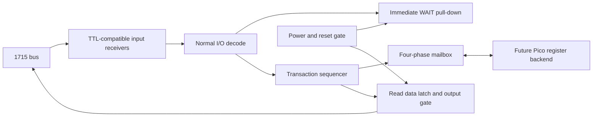

# Executable bus frontend prototype

`rtl/bus_frontend.v` is an original MIT-licensed, synthesizable reference for the
ordinary PC1715 **normal-I/O transport**. It is a bench design, not a complete
floppy controller, fitted CPLD design, or a Pico firmware release. The existing
C controller remains the stock-software reference. The two are not co-simulated
yet; passing these tests does not demonstrate an HDL boot of SCP.

The next implementation decision now has an executable baseline: immediate wait
assertion, capture once, response-data settling, completion, and handshake drain.
The backend can eventually be Pico PIO plus RAM/DMA, or local register logic.
No host connector contact or programmable-logic device is frozen by this work.



## Scope and protocol

| Host operation | Action |
|---|---|
| Normal I/O, ports 00h–07h | Read or write mailbox request, reg 0–7 |
| Normal I/O write, ports 20h–23h | Drive-select mailbox request, reg 8–11; backend must alias these |
| Read 20h–23h, other ports, memory cycles | Unclaimed; no wait or data output |
| /M1 active with /IORQ | Interrupt acknowledge bypasses this normal-I/O module |
| /RD and /WR both active or both inactive | Unclaimed |

The upper address byte is ignored, matching the software model. Raw address
bits are used for the reference decode; a final schematic may use motherboard
selects after verification. IRQ generation, vector response, daisy-chain priority
and RETI observation need their own frontend logic. In particular, **this module
cannot be connected as the complete FDC**: it intentionally never drives IACK.

1. A selected cycle asserts `wait_pull_low` combinationally. This output means
   enable an external open-drain pull-down; it must never drive /WAIT high.
2. The next local clock captures direction, register and write data once, then
   raises `request`. The host must hold address/direction/data while waiting.
3. Backend observes request, performs the operation once, establishes response
   data, then raises `response_ack`. It holds data and ACK until request falls.
4. ACK crosses two synchronizer registers. The sequencer captures response data,
   enables a selected read's output, and spends one full local clock in SETTLE
   before releasing WAIT. Writes never enable host data output.
5. The request remains high through the host cycle. Once strobes end it falls;
   backend lowers ACK. The sequencer drains the synchronized ACK before reuse.

The backend must synchronize request in its own domain. Both multibit payloads
are **bundled data**, not independently synchronized bits. Request payload must
remain stable throughout request; response data must be stable before ACK rises
and until request falls. A real CDC design must constrain these paths and review
metastability/MTBF. Simulation does not prove that review. The host's inactive
interval must span at least one local clock so COMPLETE observes cycle end;
back-to-back cycles meeting that contract may wait while ACK drains.

Unexpected host abort before COMPLETE latches a fault. Merely dropping request
and accepting a new transaction could mistake a late reply for the new reply.
The fault quarantines the mailbox until **both ends are reset**. A backend write
already accepted before abort is not rolled back.

Reset or loss of `power_good` asynchronously gates host drive and WAIT off;
release is synchronized. `power_good` must come from real reset/power supervision,
not a software promise. Backend ACK must be low after the shared reset.
A stuck ACK or missing response times out and latches fault, drops request and
releases WAIT with no fabricated data response. Software may fail that cycle;
this is a bench fail-open policy, not a stock BIOS error-reporting implementation.
A missing local clock cannot advance the watchdog: a final design needs a
clock-loss/reset strategy independent of this counter.

## Timing budget to take to the bench

The test fixture uses **50 MHz**, a proposed local clock rather than a guaranteed
device capability. RTL simulation has zero combinational propagation delay.

| Path | Current reference | Still required |
|---|---|---|
| Host /WAIT assertion | Asynchronous decode and gate; no clock/firmware wait | Worst-case receiver + decode + drain-driver delay, CPU sampling setup, hazards and board skew |
| Request capture | First local clock after selected cycle | Host data setup and CDC analysis |
| ACK to WAIT release | Up to four local clocks under the bundled-data assumptions | Backend implementation, synchronizer placement and routed timing |
| Read data before WAIT release | One full local clock, 20 ns in fixture | Output register/translator/board delay and actual CPU data setup/hold |
| Watchdog | 4,096 clocks, nominal 81.92 us at 50 MHz | Refresh-safe bound, real error behavior and clock-loss handling |

The timeout is deliberately longer than one 32 us disk-byte interval. It is an
**experimental bound**, not evidence that 81.92 us stalls are safe for the
motherboard's DRAM. The one-clock settling interval is likewise a design knob,
not a proved electrical margin. Data-enable drops with the host read strobe;
verify hold time after the CPU sampling edge before choosing output buffers.

## GPIO and component consequences

A straightforward Pico connection to the logical mailbox requires 23 signals:
8 write-data + 8 read-data + 4 register + direction + request + ACK. A shared reset
adds one. Separate SPI SD (4 pins) and quad-SPI RAM (6 pins) bring that to **34**,
before interrupts/debug. This does not fit a standard Pico's 26 exposed GPIO.
[Raspberry Pi's board documentation](https://www.raspberrypi.com/documentation/microcontrollers/pico-series.html)
is the reference for the exposed-pin count; board-owned pins must not be counted
as freely available header pins.

An **unimplemented shared 8-bit mailbox** could reduce the above to 26 pins:
8 data + 4 register + direction + request + ACK + reset + 4 SD + 6 RAM.
That leaves no interrupt or debug reserve. Sharing SD/RAM signals or using SPI
RAM can save pins, but would introduce contention and throughput decisions.
Alternatively, keep the visible register/IRQ machinery in programmable logic
and use a narrower FIFO transport to the Pico. Neither choice is proven here.
This budget is a reason to prototype the transport before buying a carrier;
it does not prove a particular CPLD is necessary or sufficient.

For the bench, use distinct receive and drive paths rather than assuming any
bidirectional level translator will work with a TTL host:

- A **3.3 V SN74LVC245A receiver** accepts inputs up to 5.5 V and has TTL-compatible
  thresholds at the relevant supply. Its partial-power-down behavior is documented
  by [TI](https://www.ti.com/product/SN74LVC245A). Use a fixed host-to-logic direction.
- A **5 V SN74AHCT245 output path** has TTL-compatible inputs, allowing a 3.3 V
  control/data source; see [TI](https://www.ti.com/product/SN74AHCT245). Pull /OE
  inactive on the powered host side and provide gating that works with logic
  unpowered. Do not assume this family inherits another part's Ioff behavior.
- **SN74LVC8T245 is not automatically a suitable host receiver.** Its 4.5–5.5 V
  port specifies VIH = 0.7 × VCCI, rather than a TTL-level threshold. Check the
  host's guaranteed VOH against that requirement, not just the permitted voltage
  range. See [TI's electrical table](https://www.ti.com/lit/ds/symlink/sn74lvc8t245.pdf).

These are interface candidates, not a BOM. Verify actual UB880/UB855 and board
logic limits, loading, pull-ups, propagation, power sequencing and output hold.
Do not connect Pico pins directly to X2. `/WAIT` and future `/INT` require suitable
open-drain/collector interfaces and confirmed host pull-ups. The final power and
reset circuit must keep the output drivers inactive even before configuration.

## Reproduce and bench handoff

```sh
# Requires Python 3, C compiler, Icarus Verilog, Verilator and Yosys.
python3 tools/check_frontend.py --out local/frontend-check.json
```

The checker runs existing model unit tests, frontend simulation, warning-clean
RTL lint, and generic synthesis with structural checks. It records versions,
source hashes and results. Waveforms are at `build/frontend.vcd`; the synthesis
log is `build/frontend-synthesis.log`. Generic cell counts are **not CPLD
macrocells or FPGA LUT counts**, and synthesis does not establish timing closure.
The checked-in result is [frontend-prototype.json](../reports/frontend-prototype.json).

Tests cover every low-byte port and direction, upper-byte aliases, all 256 data
patterns, held strobes, 20 arrival phase offsets, varying response delays,
IACK/memory exclusion, aborted requests, stale ACK, backend timeout, reset and
power loss. Read-data lead time is asserted explicitly.

Before the first machine connection:

1. Select a development logic device and add its clock/reset/pin constraints;
   implement the mailbox backend and IRQ/RETI path. Run routed timing and CDC review.
2. Drive host signals from a fixture through the proposed receivers. Capture
   address, /IORQ, /M1, /RD, /WR, /WAIT, data, /OE, request, ACK, reset and fault.
3. Measure assertion/setup/hold and bus turnaround; stop either endpoint and
   reset/power-cycle each rail independently. Verify no contention or back-power.
4. Resolve the X2 orientation/interrupt-chain discrepancy, then connect through
   the verified interface and run the existing stock-software workloads.

This work supplies the transport reference and reproducible fault tests for that
handoff. It does not mark the physical prototype or PCB-order gate complete.
